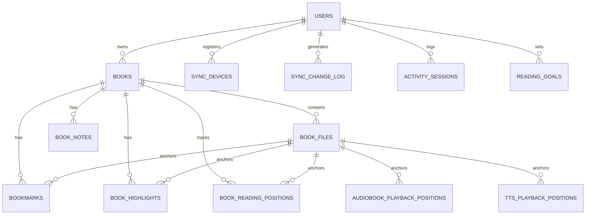

# Reading Sanctuary — Database Schema Documentation

## 1. Migration Overview

All database migrations are managed via **Flyway** under `src/main/resources/db/migration/`:

- `V1__init_schema.sql`: Users and authentication.
- `V2__create_books_table.sql`: Books and core library records.
- `V3__create_book_files_table.sql`: Book file attachments, formats, storage keys.
- `V4__create_reading_positions_table.sql`: Format-aware reading positions.
- `V5__create_audiobook_positions_table.sql`: Audiobook playback tracking.
- `V6__create_tts_positions_table.sql`: Text-to-Speech playback tracking.
- `V7__create_bookmarks_highlights_notes.sql`: Annotations and personal notes.
- `V8__create_analytics_tables.sql`: Activity sessions, streaks, reading goals.
- `V9__create_sync_infrastructure.sql`: Devices, change log, idempotency, S3 metadata.

---

## 2. Entity Relationship Diagram

---

## 3. Table Details

### 3.1 `sync_change_log`
- `id` (BIGINT GENERATED ALWAYS AS IDENTITY PRIMARY KEY)
- `user_id` (UUID NOT NULL REFERENCES users(id))
- `cursor` (BIGINT NOT NULL)
- `entity_type` (VARCHAR(50) NOT NULL)
- `entity_id` (VARCHAR(100) NOT NULL)
- `operation` (VARCHAR(20) NOT NULL) — `CREATE`, `UPDATE`, `DELETE`
- `entity_version` (BIGINT NOT NULL DEFAULT 1)
- `payload` (TEXT)
- `changed_at` (TIMESTAMP WITH TIME ZONE NOT NULL DEFAULT NOW())

### 3.2 `sync_devices`
- `id` (UUID PRIMARY KEY DEFAULT gen_random_uuid())
- `user_id` (UUID NOT NULL REFERENCES users(id))
- `device_name` (VARCHAR(150) NOT NULL)
- `platform` (VARCHAR(30) NOT NULL)
- `last_sync_cursor` (BIGINT NOT NULL DEFAULT 0)
- `last_seen_at` (TIMESTAMP WITH TIME ZONE)
- `is_active` (BOOLEAN NOT NULL DEFAULT TRUE)

### 3.3 `sync_processed_changes`
- `client_change_id` (VARCHAR(100) NOT NULL)
- `user_id` (UUID NOT NULL REFERENCES users(id))
- `processed_at` (TIMESTAMP WITH TIME ZONE NOT NULL DEFAULT NOW())
- PRIMARY KEY (`client_change_id`, `user_id`)
