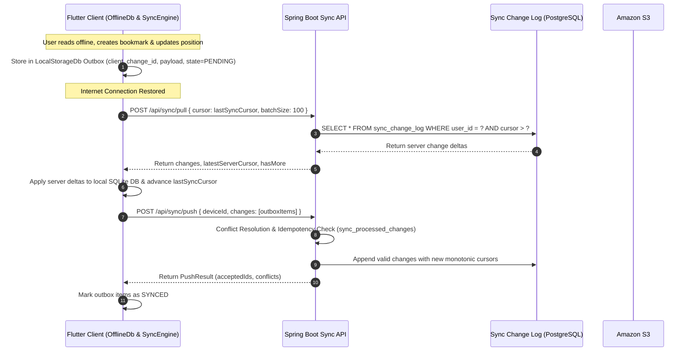

# Reading Sanctuary — Offline Synchronization Architecture

## 1. Architectural Principles

Reading Sanctuary is designed with an **offline-first** philosophy. Users can read books, highlight passages, create bookmarks, write chapter notes, and track reading progress without an active internet connection. When connectivity is restored, the client transparently synchronizes with the server without loss of data.

---

## 2. Core Synchronization Mechanics

### 2.1 Monotonic Sequence Cursor
- The server maintains a globally monotonic auto-incrementing `cursor` (`BIGINT`) per user within `sync_change_log`.
- Clients track their own `last_sync_cursor`.
- Pull operations are delta-only: `WHERE user_id = :userId AND cursor > :clientCursor ORDER BY cursor ASC LIMIT :batchSize`.

### 2.2 Client Outbox & Idempotency
- When an entity is modified offline, the client generates a unique `client_change_id` (UUIDv4) and enqueues the operation in the local `sync_outbox` table.
- When pushing to the backend, the server checks the `sync_processed_changes` table (`client_change_id`, `user_id`).
- If an operation was already processed (e.g., due to a dropped HTTP response), the server returns success without duplicating database state or re-emitting events.

---

## 3. Conflict Resolution Strategies

Different domain entities require distinct conflict resolution heuristics:

| Entity Type | Resolution Strategy | Description |
|---|---|---|
| **Reading Positions** | **Latest Timestamp Wins (LWW)** | The position with the most recent `updated_at` epoch timestamp takes precedence. Prevents reverting progress when switching devices. |
| **Audiobook / TTS Positions** | **Latest Timestamp Wins (LWW)** | Most recent playback position wins. |
| **Bookmarks** | **Additive Merge by ID** | Identified by stable client-generated UUIDs. Bookmarks created across multiple devices merge seamlessly into the library. |
| **Highlights** | **Additive Merge by ID** | Identified by client UUID. Range overlapping can be resolved visually. Color updates apply LWW. |
| **Book Notes** | **3-Way Versioning & Fork** | If client version matches server version, update applies cleanly. If conflicting edits occur on distinct devices, the server preserves the server version and stores the conflicting edit as a separate draft note with a `(Conflicted Copy)` title. |
| **Deletions** | **Tombstones** | Deletions are logged with `operation = 'DELETE'` and a tombstone payload, ensuring peers remove the deleted resource from local storage. |

---

## 4. Binary File Offline Storage (`DownloadManager`)

Binary files (PDFs, EPUBs, Audiobooks) are managed independently from structured sync data to optimize bandwidth:

1. **Direct Download**: The client requests a presigned S3 GET URL from `/api/storage/download-url/{fileId}`.
2. **Chunked Local Storage**: Flutter's `DownloadManager` writes chunks to app-isolated disk storage (`getApplicationDocumentsDirectory()`).
3. **Integrity Verification**: Upon completion, the client computes the SHA-256 digest of the downloaded file and verifies it against the server-provided hash before flagging the file as `DOWNLOADED`.
4. **Local Fallback**: `ReaderFileService` queries `DownloadManager.getLocalFilePath(fileId)`. If present and valid, the document reader loads from local disk without hitting the network.
5. **Storage Management**: Users can inspect storage usage by book and purge local binary caches on demand via the Storage Management screen.
