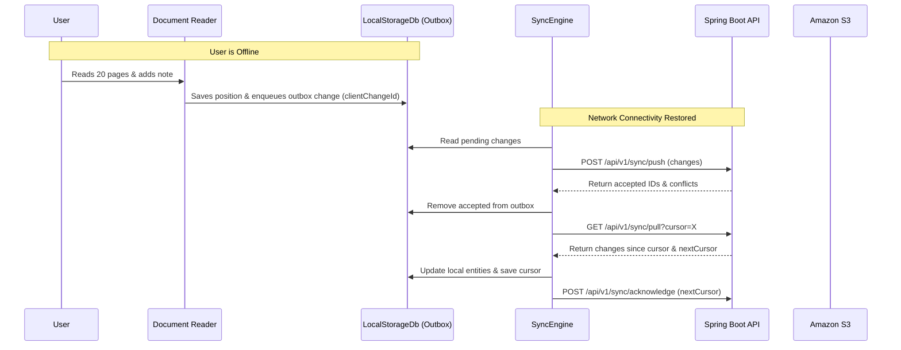

# Reading Sanctuary — Offline & Synchronization Architecture

## 1. Offline-First Philosophy

Reading Sanctuary operates reliably without an active network connection:
1. **Downloaded Books**: Book files (PDF, EPUB, DOCX, MP3, M4B) stored locally in the application sandbox.
2. **Local Reads**: Reader and audio player read directly from local filesystem paths.
3. **Outbox Queue**: All mutations made offline (reading positions, notes, bookmarks, goals) are assigned a unique `clientChangeId` and queued in `sanctuary_outbox.json`.
4. **Automatic Reconnection Sync**: When network connectivity resumes, the `SyncEngine` flushes the outbox and pulls server updates.

---

## 2. Conflict Resolution Policies

| Entity Type | Conflict Policy | Reason |
|---|---|---|
| **Reading & Audio Positions** | **Latest Progress Wins** | Position monotonically advances with reading progress. |
| **Bookmarks & Highlights** | **Merge by ID** | Distinct bookmarks/highlights created across devices are both preserved. |
| **Activity Sessions** | **Idempotent Merge** | Session UUID ensures each reading session is only counted once. |
| **Book Notes & Reviews** | **Version Checking / 3-Way Choice** | If `baseVersion < serverVersion`, flag `VERSION_CONFLICT`. User can choose "Keep Local", "Keep Server", or "Keep Both". |
| **Deletions** | **Server Tombstone Precedence** | If deleted on server, remote delete wins. |
