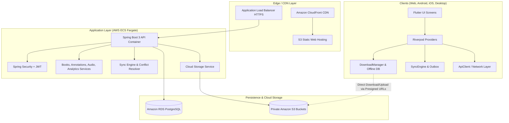

# Reading Sanctuary — System Architecture

## 1. Architectural Overview

Reading Sanctuary is a multi-platform, offline-first digital reading sanctuary supporting EPUBs, PDFs, DOCX documents, audiobooks (MP3/M4B), and Text-to-Speech (TTS), connected to a unified cloud storage and synchronization engine.

---

## 2. Component Responsibilities

| Layer | Component | Core Responsibility |
|---|---|---|
| **Frontend** | Flutter 3.47 + Dart 3.13 | Cross-platform presentation for Web, Android, iOS, and Desktop. |
| **State** | Riverpod 2.6 | Predictable reactive state management and dependency injection. |
| **Navigation** | GoRouter 14.8 | Deep linking, declarative routing, browser history, and auth guards. |
| **Offline Persistence** | `LocalStorageDb` | Device identity, cursor tracking, outbox queue, cached files index. |
| **Offline Files** | `DownloadManager` | Local file download, SHA-256 verification, and storage cleanup. |
| **Backend API** | Spring Boot 3.x (Java 25) | Stateless REST API, authorization, business rules, sync coordination. |
| **Database** | PostgreSQL + Flyway | Source of truth for users, books, metadata, progress, sync logs. |
| **Object Storage** | Amazon S3 | Private binary storage for PDFs, EPUBs, DOCX, and audiobooks. |
| **Security** | Spring Security + JWT | Stateless bearer token authentication and user isolation. |
