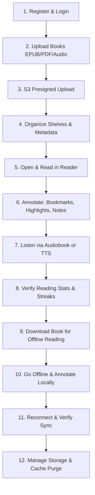

# Reading Sanctuary — End-to-End User Journey Verification

This guide outlines the 12-step validation script to verify that the integrated Reading Sanctuary system operates flawlessly across client, server, database, and cloud storage.

---

## The 12-Step Verification Journey

---

### Step 1: User Registration & Authentication
- **Action**: Launch the Flutter application. Navigate to `/register`. Register a new account (`reader@sanctuary.org` / `Pass1234!`).
- **Expected Outcome**: Account is persisted in PostgreSQL `users` table with BCrypt hashed password. User is automatically logged in and redirected to the Library screen (`/library`) with a valid JWT in session state.

### Step 2: Book Ingestion
- **Action**: Click "Add Book" / "Upload". Select an EPUB, PDF, and an MP3 audiobook file. Enter title and author.
- **Expected Outcome**: Book entity is created via `POST /api/books`.

### Step 3: Direct S3 Presigned Upload & Verification
- **Action**: Observe upload progress indicators for attached files.
- **Expected Outcome**: Client requests presigned S3 URLs from `/api/storage/upload-intent`. Binary bytes upload directly to S3. Client issues `/api/storage/complete-upload` with SHA-256 hash. Status switches to `READY`.

### Step 4: Library Organization
- **Action**: Assign the book to a Bookshelf (e.g., "Currently Reading") and tag it with "Classics".
- **Expected Outcome**: Shelves and tags update immediately with optimistic UI updates.

### Step 5: Document Reading Experience
- **Action**: Tap "Read Now". The reader launches with Dark Academia theme (sepia background, ink text).
- **Expected Outcome**: Format-appropriate reader renders the document (EPUB CFI navigation, PDF page renderer, DOCX reflow). Reader position updates periodically.

### Step 6: Annotation Workflow
- **Action**: Select a passage and highlight it in Amber. Add an annotation note ("Crucial theme"). Add a bookmark on the current page.
- **Expected Outcome**: Highlight is drawn immediately. Bookmark appears in the reader drawer. API receives annotation payloads.

### Step 7: Audiobook & TTS Listening
- **Action**: Switch to the audio player tab or tap "Listen with TTS".
- **Expected Outcome**: Audiobook playback starts with scrubber, chapter markers, speed control (0.75x–2.0x), and sleep timer. Progress is logged to `/api/books/{id}/audiobook-position`.

### Step 8: Reading Analytics Dashboard
- **Action**: Navigate to `/analytics`.
- **Expected Outcome**: Dashboard displays accurate stats: Total reading minutes, pages read, current streak (1 day), daily goal progress bar, and calendar heatmap.

### Step 9: Offline Download
- **Action**: On the book details screen, tap the "Download for Offline" button.
- **Expected Outcome**: Download progress bar updates. `DownloadManager` saves chunks locally, verifies the SHA-256 checksum, and marks status as `DOWNLOADED`.

### Step 10: Offline Mode Reading
- **Action**: Enable Airplane Mode (or terminate backend API server). Open the downloaded book. Read 5 pages, add 2 highlights and 1 bookmark.
- **Expected Outcome**: Document loads instantly from local storage. Annotations succeed without error and are queued in `LocalStorageDb` outbox. The `SyncStatusIndicator` displays "Offline (3 pending changes)".

### Step 11: Reconnection & Bidirectional Sync
- **Action**: Disable Airplane Mode / restart backend API.
- **Expected Outcome**: `SyncEngine` detects network connectivity, initiates delta sync. Outbox items push to server (`POST /api/sync/push`), server accepts changes, and `SyncStatusIndicator` transitions to "Synced (Up to date)".

### Step 12: Storage Management & Purge
- **Action**: Navigate to `/storage/manage`.
- **Expected Outcome**: Screen details storage used by downloaded books, cache files, and audio assets. Tapping "Delete Download" removes the local file and frees disk space while preserving remote book metadata and reading history.
